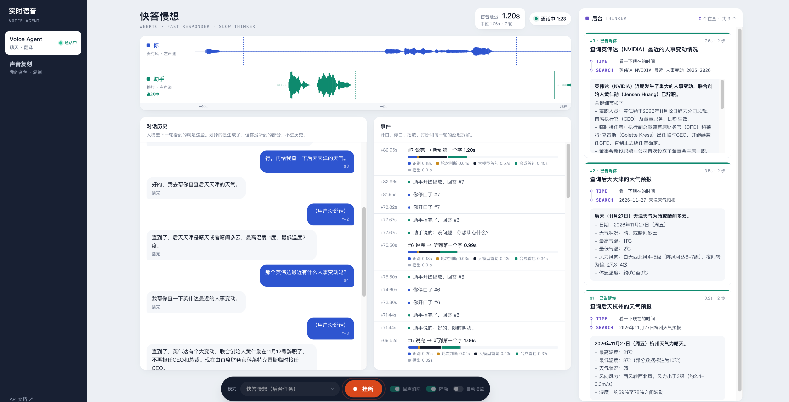

# Voice Agent

**一个可打断、能在后台查资料的实时语音 Agent。**

你可以和它自然交谈，在它说话时插话；也可以让它去查资料，自己继续聊别的，等查到了再听它告诉你。项目同时提供中文到英文的语音翻译、语音变声和声音复刻页面。

基于 Python、FastAPI 和可组合的音频 pipeline，支持 WebRTC 与 WebSocket，结合本地 MLX 模型和云端语音服务。



## 先听听效果

下面是实际会话录音。**左声道是用户，右声道是助手**，建议戴耳机听。

| 录音 | 内容 | 时长 |
| --- | --- | --- |
| [普通对话](./samples/simple.mp3) | 基础语音聊天 | 约 1 分 38 秒 |
| [和自己聊天](./samples/talk2myself.mp3) | 使用作者复刻音色的 WebRTC 对话 | 约 5 分 21 秒 |
| [父亲与女儿聊弹琴](./samples/father_daughter_piano.mp3) | 较长的 WebRTC 情景对话 | 约 6 分 47 秒 |

GitHub README 不支持直接播放这些音频，可点击链接下载收听。

## 它做了什么

### 让对话跟上人的节奏

说话时的停顿，不一定意味着说完了。项目用 smart-turn 模型判断一段话是否完整；如果还没说完，就继续等待并合并后续输入。

助手说话时，你可以直接插话。流式识别的中间结果用于提前判断打断，“嗯嗯”“对对对”等附和会被过滤；说“闭嘴”则立即停止当前回复。打断会取消正在进行的 LLM 和 TTS，并清理待播放音频。

如果你在助手还没开口时接着补充，前后两段输入会合并，再重新生成回答。

### 记住用户实际听到的内容

助手生成了一整段话，但你只听了一半就打断了它，下一轮的历史也应该反映这件事。

`ConversationContext` 根据 transport 报告的播放进度修正回复：默认只保留完整播出的句子，并标记被打断。WebRTC 按服务端音频帧记录进度；WebSocket 按音频时长估算。片段内的文字截断使用时长比例估算，不是逐字对齐。

页面可以同时查看完整生成内容、被打断的部分，以及下一轮模型实际读取的对话历史。

### 快答慢想：聊天和查资料同时进行

前台 **Responder** 负责及时回应，后台 **Thinker** 负责搜索、读网页和其他慢任务。

```text
用户 ⇄ Responder ── 委派 ──▶ Orchestrator ──▶ Thinker × N
          ▲                                      │
          └────────────── 查询结果 ────────────────┘
```

- 查资料期间，前台仍然可以继续对话。
- 结果回来时，双方都没说话就主动告知；有人在说话，就留到下一轮回复。
- 插话取消当前回复，后台查询继续；明确取消任务或结束会话才停止后台工作。
- 页面实时显示每个任务的搜索、网页读取和执行结果。

默认后台工具包括取时间、DeepSeek 搜索和网页读取，也可以替换成自己的工具。

### 看清延迟花在哪里

每轮对话都有延迟拆解：识别、轮次判断、LLM 首句、TTS 首包和音频输出。日志、页面分段条以及会话结束时的 p50/p90 汇总，帮助定位等待发生在哪一步。

## 功能与模式

| 功能 | 说明 | 入口 |
| --- | --- | --- |
| 语音助手 | 多轮对话、smart turn、插话打断 | WebRTC / WebSocket |
| 快答慢想 | 前台对话，后台并行执行任务 | WebRTC 的 `stfr` 模式 |
| 语音翻译 | 中文识别后生成英文语音；片段不足时可以等待补充 | WebRTC / WebSocket |
| 本地 LLM 聊天 | 通过独立的 MLX LLM 服务生成回答 | WebRTC 的 `simple_chat` 模式 |
| 变声 | 识别中文，再用另一个音色合成中文 | WebSocket |
| 声音复刻 | 浏览器录音或上传样本，训练、管理和试听火山音色 | `/voice_clone` |

“本地 LLM 聊天”指对话模型在本机运行，该模式的默认识别和语音合成仍使用云服务。变声走识别再合成，不是直接转换原始波形。

## 快速开始

需要 **Python ≥ 3.10**。MLX 是可选依赖：只有用到本机模型时才需要（Qwen3 识别 / 合成、本地 LLM，仅支持 Apple Silicon macOS）。只用云端服务（腾讯识别 + OpenRouter + 火山 TTS）时不用装，服务照常启动。

### 1. 安装

```bash
git clone https://github.com/Kira1108/realtime-translate.git
cd realtime-translate/voice_agent
python -m venv .venv
source .venv/bin/activate
brew install portaudio
pip install -r requirements.txt
pip install -r requirements-mlx.txt   # 可选：本机 MLX 模型，仅 Apple Silicon macOS
```

没装 MLX 时，用到本机 Qwen3 识别 / 合成的会话（WebSocket 翻译 / 变声、WebRTC 的翻译模式）会在第一次用模型时报错，并提示安装 `requirements-mlx.txt`；`simple_chat` 需要先用 `mlx-lm` 起本地 LLM 服务（见下文）；其他模式不受影响。

`portaudio` 用于依赖列表中的 PyAudio；浏览器通话本身不通过 PyAudio 采集麦克风。

### 2. 配置服务

建议首次体验使用：**腾讯流式识别 + OpenRouter LLM + 火山 TTS**。

```bash
export OPENROUTER_API_KEY="你的 OpenRouter API Key"
export VOLC_TTS_API_KEY="你的火山 TTS API Key"
export TENCENT_ASR_SECRET_ID="你的腾讯云 Secret ID"
export TENCENT_ASR_SECRET_KEY="你的腾讯云 Secret Key"
export TENCENT_ASR_APPID="你的腾讯云 App ID"

# 体验快答慢想的搜索、读网页时需要
export DEEPSEEK_API_KEY="你的 DeepSeek API Key"
```

也可以把变量写入 `~/.env`，项目配置会读取该文件。各服务需在自己的账号下开通相应能力。

**当前 WebRTC 默认配置仍包含作者的私有 LLM 接入和复刻音色，首次运行请先调整。** 打开 [`voice_agent/app/routers/webrtc.py`](./voice_agent/app/routers/webrtc.py)，将 `chatbot_components()` 和 `stfr_components()` 改为下面的组合。文件中已经导入了这些类和函数。

```python
def chatbot_components():
    return [
        TencentSTTComponent(),
        BargeInAggregator(),
        NaiveAgentComponent(model=open_router_model()),
        VolTTSComponent(VolTTS()),
    ]


def stfr_components():
    return [
        TencentSTTComponent(),
        BargeInAggregator(),
        STFRComponent(
            model=open_router_model(),
            thinker_model=open_router_model(),
        ),
        VolTTSComponent(VolTTS()),
    ]
```

`open_router_model(model_name="...")` 可以指定账号可用的模型；快答慢想需要模型支持工具调用。`VolTTS()` 使用默认音色，替换为其他音色时需确认账号拥有对应权限。

仓库内已包含 `models/turn/smart-turn.onnx` 和 `models/vad/silero_vad.onnx`。上述云端聊天组合不需要下载本地 Qwen3 权重。

### 3. 启动与通话

在 `voice_agent/` 目录下运行：

```bash
uvicorn app.main:app --host 127.0.0.1 --port 8000
```

打开 [http://localhost:8000/](http://localhost:8000/)，进入 **Voice Agent**，选择聊天模式并开始通话；也可以直接打开 [WebRTC 页面](http://localhost:8000/webrtc)。体验快答慢想时选择对应模式。

浏览器会请求麦克风权限，可启用回声消除和降噪。麦克风访问需要 `localhost` 或 HTTPS；用局域网 IP 的普通 HTTP 页面可能无法录音。

### 4. 可选：本地模型

本地权重按下面的目录放置，目录内应包含模型所需的配置、权重等完整文件：

```text
voice_agent/models/
├── stt/qwen3-stt/                   # 本地识别：翻译、变声使用
├── tts/qwen3-tts/                   # 本地合成：变声使用
├── llm/gemma-4-e2b-it-qat-4bit/      # 本地 LLM，可选
├── vad/silero_vad.onnx
└── turn/smart-turn.onnx
```

仓库的模型复制脚本使用作者本机的缓存路径，使用前需要调整源路径和目标路径。STT / TTS 脚本中对应的模型分别为 `mlx-community/Qwen3-ASR-0.6B-8bit` 和 `mlx-community/Qwen3-TTS-12Hz-0.6B-CustomVoice-8bit`。

本地 LLM 通过独立进程提供 OpenAI 兼容接口。准备好权重并安装 `requirements-mlx.txt`（含 `mlx-lm`）后，在仓库根目录的另一个终端运行：

```bash
bash bash_scripts/start_mlx_llm.sh
```

然后选择 `simple_chat` 模式。默认地址是 `http://127.0.0.1:8091/v1`，可通过 `MLX_LLM_BASE_URL` 修改。本地模型首次使用时加载，首轮会更慢。

WebRTC 翻译模式同样需要把 `translator_components()` 中的私有 LLM 改成可用的模型，并把复刻音色替换成自己的音色或 `VolTTS()`。

## 工作原理

```text
语音助手 / 快答慢想
麦克风 → WebRTC / WebSocket → 流式 STT → 轮次管理 → LLM → 流式 TTS → 播放
                                         │         │
                                         │         └─ 可选：后台 Thinker
                                         └─ smart turn / 附和过滤 / 插话打断

语音翻译
麦克风 → VAD 切片 → 本地 STT → 翻译 LLM（翻译或等待补充）→ 流式 TTS → 播放

变声
麦克风 → VAD 切句 → 本地 STT → 本地 TTS → 播放
```

数据沿 pipeline 流动，会话控制总线负责打断、停止和说话状态。每一轮通过 `utterance_id` 关联输入、生成、合成、播放和延迟统计。

STT、LLM、TTS 和 transport 可以分别替换。同一套对话组件可以用于 WebRTC 和 WebSocket；本地 Qwen3 模型在进程内共享，推理通过专用线程排队执行。

### 轮次与打断

| 场景 | 默认行为 |
| --- | --- |
| 用户短暂停顿，语义还没结束 | smart turn 判断后继续等待，后续语音并入草稿 |
| 用户持续说话 | 暂不提交当前轮次 |
| 助手说话时用户附和 | 过滤匹配的附和，不触发打断 |
| 用户说“闭嘴” | 停止当前回复，该指令不交给 LLM |
| 用户提出新的内容 | 根据中间识别结果触发打断，转入下一轮 |
| 助手还在思考时用户补充 | 合并前后输入，重新生成 |

这些行为由模型判断和可配置规则共同实现，附和字表、停止词、最少字数及等待时间都可调整。详见 [轮次管理说明](./voice_agent/app/plugins/turn/docs/README.md)。

## 延迟与调试

已有一次 M2 Max 上的 **5 轮实测**，使用腾讯流式 STT、smart turn、本地 MLX Gemma 4 E2B 和火山 TTS：服务端统计 **p50 0.87 秒，p90 1.09 秒**。

这是特定配置的小样本结果，不代表所有模式。计时从用户语音结束到服务端首音频输出，不包含完整的浏览器接收和播放延迟；WebRTC 的输出点是服务端音轨播出，WebSocket 的输出点是发出音频。

```text
语音结束 → STT 最终结果 → 轮次判断 → LLM 首句 → TTS 首包 → transport 输出
```

用 DEBUG 日志查看各环节和打断决策：

```bash
LOG_LEVEL=DEBUG uvicorn app.main:app --port 8000
```

WebRTC 页面也会显示双轨说话时间线、每轮延迟、对话历史；快答慢想模式额外显示后台任务过程。聊天会话默认录制双声道音频，输出在仓库的 `output/recordings/` 下。

## 接口与客户端

| 接口 | 用途 |
| --- | --- |
| `POST /webrtc/{agent}/offer` | WebRTC SDP 信令，`agent` 为 `chatbot`、`stfr`、`simple_chat` 或 `translator` |
| `WS /websocket/chatbot` | 可打断的语音对话，默认使用 OpenRouter |
| `WS /websocket/translator` | 中文语音转英文语音，默认使用 OpenRouter |
| `WS /websocket/voice_changer` | 本地识别与合成的变声 |
| `GET /voice_clone` | 声音复刻页面 |
| `POST /voice_clone` | 上传声音样本并提交复刻 |

WebSocket 默认输入为 **16 kHz、单声道、int16 小端 PCM**；默认输出为 **24 kHz、单声道、int16 小端 PCM**。自定义 TTS 时需要同步调整客户端播放采样率。

- 二进制消息传输音频，建议每块 20–100ms，按实时速度发送。
- `{"event_type": "stop"}` 结束会话，会取消未完成的处理。
- `reply_end` 表示一轮音频已发送完成，不代表客户端已经播放完。
- 收到 `interrupt` 后，客户端应立即清空待播放音频。
- 收消息和播放应使用独立任务，避免播放阻塞收包。
- 腾讯流式识别需要持续输入音频，静音也要发送。

在 `voice_agent/` 下使用示例客户端：

```bash
# 麦克风语音聊天，建议戴耳机
python scripts/chatbot_mic.py

# 麦克风实时翻译
python scripts/voice_changer_mic.py --url ws://localhost:8000/websocket/translator

# 按实时速度发送音频文件，保存返回的英文语音
python scripts/translate_file.py 中文.wav 英文.wav --url ws://localhost:8000/websocket/translator
```

声音复刻需要账号自己的火山音色槽位。页面支持录音、上传、试听和管理音色，槽位信息保存在 `voice_agent/voices.json`，应按自己的账号配置。

## 项目结构

```text
voice_agent/
├── app/
│   ├── audio/          # VAD、smart turn、重采样、双声道录音
│   ├── context/        # 根据播放进度修正对话历史
│   ├── control/        # 会话事件与打断控制
│   ├── frame/          # 数据帧与事件
│   ├── metrics/        # 每轮延迟拆解
│   ├── pipeline/       # 组件基类与 pipeline
│   ├── plugins/
│   │   ├── stt/        # 腾讯流式识别、Qwen3 本地识别
│   │   ├── llm/        # 对话、翻译、快答慢想、模型接入
│   │   ├── tts/        # 火山 HTTP / WebSocket、Qwen3 本地合成
│   │   ├── turn/       # 轮次判断与插话规则
│   │   └── voice_clone/
│   ├── routers/        # 页面、信令与 WebSocket 接口
│   ├── static/         # 浏览器通话与声音复刻页面
│   └── transport/      # WebRTC / WebSocket 与播放进度记录
├── models/             # 本地模型
├── scripts/            # 麦克风与文件客户端
└── tests/              # 轮次、上下文、翻译、任务、延迟等测试
samples/                # 界面截图与会话录音
bash_scripts/           # 本地 LLM 启动及模型复制脚本
```

进一步阅读：[对话上下文](./voice_agent/app/context/README.md) · [控制总线](./voice_agent/app/control/README.md) · [TTS](./voice_agent/app/plugins/tts/README.md)

## 扩展与测试

增加语音服务时，可以参考现有 STT / TTS 插件，保留输入输出帧约定，再放入 pipeline。LLM 组件接受 pydantic-ai 的模型对象；后台 Thinker 可通过 `thinker_tools` 注入工具。

例如，把云端语音助手组合成：

```python
Pipeline(transport, [
    TencentSTTComponent(),
    BargeInAggregator(),
    NaiveAgentComponent(model=open_router_model()),
    VolTTSComponent(VolTTS()),
])
```

在 `voice_agent/` 目录下运行测试：

```bash
python -m pytest
```

测试不依赖 MLX，没装 MLX 的环境也能跑完整测试。

## 当前边界

- 当前是持续迭代中的开发者项目，WebRTC 默认配置需要按自己的服务账号调整。
- 默认 WebRTC 不配置 STUN / TURN，主要用于本机或局域网；公网部署需要相应的网络配置与 HTTPS。
- WebSocket 麦克风客户端没有浏览器的回声消除，外放可能导致助手打断自己，建议戴耳机。
- 对话历史默认按 50 轮限制，没有按 token 数裁剪；长对话可调小 `max_turns`。
- 本地模型冷启动、多会话推理排队、网络及所选模型都会影响延迟。
- 腾讯识别遇到代理出口问题时，检查网络路由与账号的跨境访问权限；必要时让 `asr.cloud.tencent.com` 直连。

欢迎通过 Issue 反馈可复现的问题、分享体验，或通过 PR 补充模型接入、测试和文档。
