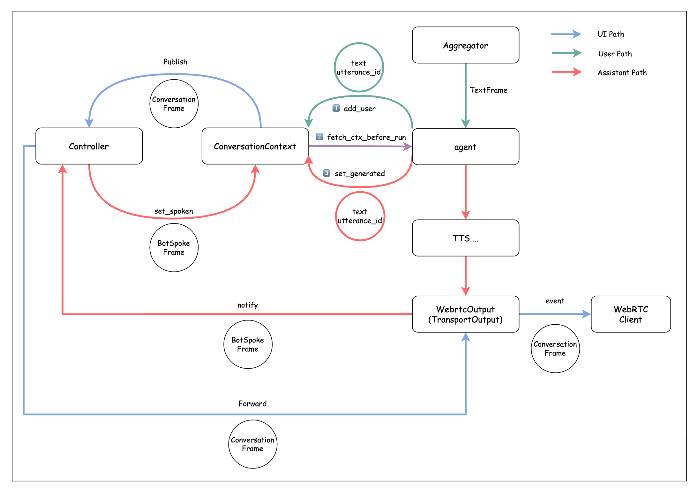

# 对话上下文（context）：只记用户真正听到的



## 要解决的问题

> 省流：解决的就是 消息错位 + 截断幻觉 的问题。

LLM 自己管对话历史时，生成完就把整段回复记下来。但在语音对话里，bot 经常说到一半就被用户打断，后面的话根本没播出去。模型下一轮会以为自己全说完了，接话就会错位。

所以历史不再交给 LLM（pydantic-ai）自己记，而是单独放在一个 `ConversationContext` 里：

- **用户说的话**：交给 LLM 时就记下。
- **bot 说的话**：只记**用户实际听到的部分**。听到了多少，只有负责播放的 transport 知道，所以要等它回报。

LLM 组件（图中的 agent）只从 context **读**历史，不再自己记。

## 三条路径

图里用三种颜色画了三条路径，下面一条一条说。

### 绿色：User Path，用户的话进入 context

1. 轮次判断（Aggregator）确定用户这一轮说完了，把 `TextFrame` 交给 agent（`NaiveAgentComponent`）。
2. **① `add_user(utterance_id, text)`**：agent 先把这句话写进 context。
3. **② `prompt_and_history(utterance_id)`**（图中的 `fetch_ctx_before_run`）：agent 再从 context 取出这一轮的提示词（prompt）和之前的历史（pydantic-ai 的 `ModelRequest` / `ModelResponse` 消息），然后才调用 LLM。

用户的话**一定会**进入历史，而且是在 LLM 开始生成之前就写进去了。

### 红色：Assistant Path，bot 的话：先暂存，再按实际播放改正

1. agent 一边生成一边按句子切分，交给 TTS。TTS 合成每句话时，会在这句**第一块音频**上带上这句的文字（`AudioFrame.text`）。
2. transport（`WebRTCOutput`）在排队时，把每块音频记到它所属的句子上（`app/transport/spoken.py` 里的 `SpokenLedger`）。播放器每播出 20ms，就在对应句子上累加"已播出"的量。
3. **③ `set_generated(utterance_id, text)`**：LLM 生成完，agent 把**生成的全文**作为暂存写进 context。如果 transport 一直没回报，下一轮就用这份暂存，等于退回到以前的行为。
4. 这一轮结束时，transport 发出 **`BotSpokeFrame`**（图中的 notify），经 controller 广播给 context，触发 **`set_spoken`**，**用实际听到的内容替换掉暂存**。结束有两种情况：
   - **播完了**：最后一块音频播出后（`on_end`）报告，每句都算听完。这个事件在 `BotStoppedSpeakingFrame` **之前**发出，保证 bot 变成空闲、下一轮可以开始之前，历史已经更新好了。
   - **被打断**：Aggregator 判断插话后发出 `InterruptFrame`，transport 清空还没播的音频，然后按每句实际播了几成来报告。如果在思考阶段就被打断，一个字都没播，也会报告，只是内容为空。

`BotSpokeFrame.sentences` 长这样：`[("从前有座山。", 1.0), ("山里有座庙。", 0.4)]`，表示每句话（准确说是每次送给 TTS 的一段）播出了几成。

### 蓝色：UI Path，把历史显示到页面上

- context 每次有变化，就把**完整历史**打包成 `ConversationFrame` 发给 controller（图中的 Publish）。会触发的变化有三种：`add_user`、`set_generated`、`set_spoken`。
- `WebRTCOutput` 订阅了这个事件，转发给页面（图中的 Forward → event），WebRTC 页面在"对话历史"一栏里显示出来。
- 只有 WebRTC 转发这个事件；WebSocket 的 transport 不转发，对脚本客户端没有影响。
- 这条路径只用于显示，不影响 LLM 读到什么。

## 一轮里，bot 那句话的状态变化

每一轮在 context 里是一个 `ContextTurn`。其中 `assistant` 是下一轮会发给 LLM 的 bot 回复，`generated` 是生成的全文（只用于页面显示）。

| 时间点 | `assistant` | `reported` |
|---|---|---|
| `add_user` 之后 | 空 | False |
| `set_generated` 之后 | 生成的全文（暂存） | False |
| `set_spoken`（播完） | 全文 | True |
| `set_spoken`（被打断） | 只保留完整听完的句子 | True，并且 `interrupted` 为 True |

两个事件谁先到都没关系：如果播放结果先到，后到的 `set_generated` 只更新 `generated`，不会覆盖已经算好的 `assistant`。同一轮已经报告过"播完"，再来的打断也会被忽略。

## 读历史时的规则（`prompt_and_history`）

- **被打断的回复**：只保留完整听完的句子，末尾加上 `interrupted_marker`（默认"（被打断）"），让模型知道自己没说完。如果一段里包含好几句（LLM 吐得快时，几句会一起送进 TTS），按字数比例判断其中哪几句已经听完。设置 `partial="cut"` 后，没说完的那半句也会保留，截断处加"…"。
- **一句都没听到**：这一轮不记 bot 回复。前后两条用户消息合并成一条，保证消息始终是用户、助手、用户、助手交替出现（Gemma 等模型的对话模板要求交替）。
- **思考阶段被打断，上一轮被重新合并**：BargeIn 会把上一轮用户的话放回草稿，和新的一句拼成一句。context 看到新的一轮以上一轮那句没被回答的话开头时，就**替换**掉上一轮，避免同一句话在历史里出现两次。
- **上限**：最多保留 `max_turns` 轮，默认 50 轮。
- **系统提示词**：用 `Agent(instructions=...)` 传入。不能用 `system_prompt=`，因为自己传 `message_history` 时，pydantic-ai 会把它丢掉。

例子：bot 讲第二个故事时，在第二句说到一半被打断。下一轮 LLM 看到的是：

```
user: 讲个故事
bot:  从前有座山。山里有座庙。庙里有个老和尚。
user: 再讲一个
bot:  从前有座山。（被打断）
user: 你刚才说到哪了
```

## 精度取决于 TTS 和 transport 能提供多少信息

| 情况 | context 能做到 |
|---|---|
| WebRTC + 每句标了文字的 TTS（`VolTTS`、`Qwen3TTS`） | 按实际播出的字节数算，精确到句 |
| WebSocket | 按音频时长估算播放进度，客户端缓冲和网络延迟算不进来 |
| TTS 没标句子（`VolTTS2`，整段一起合成） | 不知道播的是哪些字，只能保留生成的全文，被打断时加上标记 |

context 本身不关心用的是哪个 TTS。各层之间靠两个约定衔接：TTS 和 transport 之间是 `AudioFrame.text`，transport 和 context 之间是 `BotSpokeFrame`。以后换一个能给出字级时间戳的 TTS，只需要改 TTS 和 transport 那两层。

## 用法

`NaiveAgentComponent` **默认就带一个 context**，不用改任何代码：

```python
NaiveAgentComponent(model=...)                                                          # 默认
NaiveAgentComponent(model=..., context=ConversationContext(max_turns=20, partial="cut"))  # 自定义
NaiveAgentComponent(model=..., context=False)                                           # 旧行为：生成多少记多少
```

组件绑定到 controller 时，context 会跟着订阅 `BotSpokeFrame`，并通过 controller 发布 `ConversationFrame`，路由里不用另外写任何东西。翻译和变声不走 LLM 对话，不受影响。

## 相关文件

| 文件 | 内容 |
|---|---|
| `conversation.py` | `ConversationContext`：写入、读取、规则、快照 |
| `app/transport/spoken.py` | `SpokenLedger`：transport 记录每句播了多少，播完或被打断时生成 `BotSpokeFrame` |
| `app/transport/webrtc.py` | 播放时累加已播出的量；`on_end` 和打断时发出 `BotSpokeFrame`；转发 `ConversationFrame` 给页面 |
| `app/plugins/tts/component.py` | 给每句话的第一块音频带上文字 |
| `app/plugins/llm/naive_agent.py` | ① 写入用户的话 → ② 读出历史 → 调用 LLM → ③ 写入生成的全文 |
| `app/frame/events.py` | `BotSpokeFrame`、`ConversationFrame` |
| `tests/test_context.py` | 各种规则和端到端测试 |
