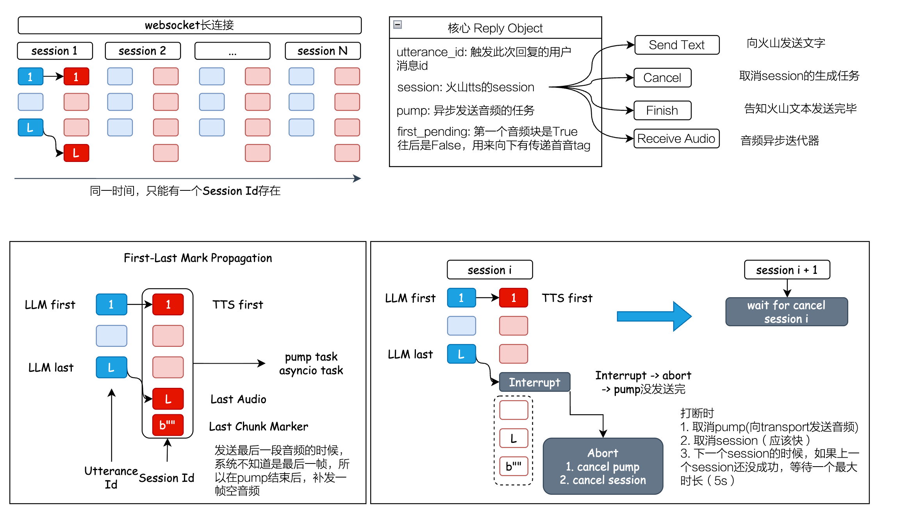

# TTS：把 LLM 的文字变成音频



## 在 pipeline 里的位置

```
LLM ──TextFrame / TextStreamFrame──▶ TTS 组件 ──AudioFrame──▶ transport
```

所有 TTS 组件对上下游的约定是一样的：

| 方向 | 约定 |
|---|---|
| 输入 | 一轮回复由若干文本帧组成，`is_first` 标第一帧，`is_end` 标最后一帧（普通 `TextFrame` 视为一整轮，两个都为 True） |
| 输出 | 一轮回复的第一块音频标 `is_first`；结束时补发一个**空的** `AudioFrame(is_end=True)`；每块音频都带上这一轮的 `utterance_id` |

transport 靠 `is_first` 知道 bot 开始说话，靠空的 `is_end` 帧知道这一轮说完了。

## 两种组件

| 组件 | 后端 | 合成方式 |
|---|---|---|
| `Qwen3TTSComponent` / `VolTTSComponent` | 本地 Qwen3 / 火山 HTTP（`VolTTS`） | **一句一合成**：LLM 每吐一句就单独请求一次，合成完再处理下一句。每句的第一块音频带上这句的文字（`AudioFrame.text`），供对话上下文判断用户听到了哪几句 |
| `VolTTS2Component` | 火山双向 WebSocket（`VolTTS2`） | **一轮一会话**：整轮回复的文字陆续送进同一个 session，音频边合成边流出来。语调更连贯，首包更快；但音频不标句子 |

下面讲 `VolTTS2Component` 的设计，也就是上图的四部分。

## 1. 一条长连接，一轮一个 session（左上）

- **WebSocket 长连接**是通道，所有轮次共用，省掉每轮建连接的时间。
- **session** 是连接上的一次合成任务，也是**归属单位**：发出去的文字、收回来的音频，每一帧都带 `session_id`，读连接的后台任务按它把帧分到对应 session。
- **一轮回复（一个 utterance）只对应一个 session**。LLM 切出来的每一句都 `send_text` 进同一个 session，服务端会把它们当成一段话重新断句合成。
- **同一时间只有一个 session**：上一个结束了，下一个才能开始。

## 2. 核心：Reply 对象（右上）

整个组件就是围着 `_Reply` 转的。**一个 `_Reply` 就是一轮回复在 TTS 这一侧的全部状态**，组件同一时间只持有一个当前的 Reply。

| 字段 | 职责 |
|---|---|
| `utterance_id`、`origin_ts` | **这是哪一轮**：判断新来的文本是不是同一轮；pump 推出的每块音频都带上它们 |
| `session` | **这一轮的 TTS 通道**：Send Text（把文字发给火山）、Finish（告诉火山文字发完了）、Cancel（取消合成）、Receive Audio（异步读音频） |
| `pump` | **把音频送到下游的后台任务**：不断从 session 读音频，推给 transport |
| `first_pending` | 下一块音频要不要标 `is_first`：第一块推出后就变成 False |

session 和 pump 都是懒创建的：第一个有字的文本到来时才打开。

Reply 把两个世界接起来：火山只认 `session_id`，下游只认 `utterance_id` 和首尾标记。**Reply 绑定了 session 和 utterance，并负责把首尾标记重新打到音频上**。pump 引用的是自己那一轮的 Reply，所以就算组件已经换到下一轮，旧 pump 推出的音频也不会串到新的一轮。

## 3. 首尾标记怎么传下去（左下）

火山不知道我们的首尾标记，标记是组件自己打上的：

- **首标记**：LLM 的 `is_first` 创建新的 Reply（`first_pending=True`），pump 推出的第一块音频标上 `is_first`。
- **尾标记**：LLM 的 `is_end` 触发 **Finish**：发 FinishSession，等 pump 读完全部音频（收到服务端的 SessionFinished），然后**补发一个空帧 `b""` 标 `is_end`**。

为什么要补一个空帧：服务端是一块一块往回发音频的，只有收到 SessionFinished 才知道发完了，那时最后一块音频早已推给下游，没法再回头给它打标记。

## 4. 打断（右下）

一轮回复只有两种结束方式：

- **Finish**：正常结束，见上一节。
- **Abort**：打断（`InterruptFrame`），或者上一轮没收到 `is_end` 新一轮就来了。当场执行，不阻塞：
  1. 取消 pump：不再往 transport 推音频，没推完的就丢掉；
  2. 取消 session：在后台发 CancelSession，不等结果。

下一个 session 打开时，会先**等上一个 session 被服务端确认结束**（因为同一时间只能有一个 session），最多等 5 秒（`session_wait_secs`），超时就重建连接。

## 选哪个

- 想要语调连贯、首包快：`VolTTS2Component`。
- 想让对话上下文精确到"用户听到了哪几句"：`VolTTSComponent`，因为它每句都标了文字；用 `VolTTS2` 时，被打断的回复只能保留生成的全文，再加上被打断的标记（见 `app/context/README.md`）。

复刻音色（`S_` 开头）直接传给 `speaker`，两个 TTS 都会自动选用 `seed-icl-2.0` 资源。

## 文件

| 文件 | 内容 |
|---|---|
| `component.py` | 三个组件：`Qwen3TTSComponent`、`VolTTSComponent`、`VolTTS2Component`（含 `_Reply`） |
| `vol_tts2.py` | 火山双向 WebSocket 客户端：长连接、session 的开启 / 结束 / 取消、按 `session_id` 分发帧 |
| `volc_protocol.py` | 火山 V3 二进制协议的编解码 |
| `vol_tts.py` | 火山 HTTP 流式合成，一句一请求 |
| `qwen3_tts.py` | 本地 Qwen3 TTS（MLX），模型全进程共享 |
